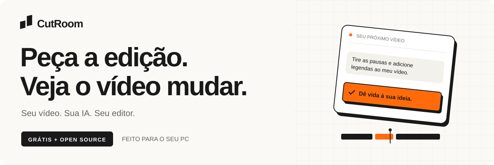
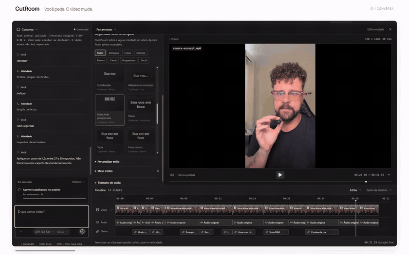
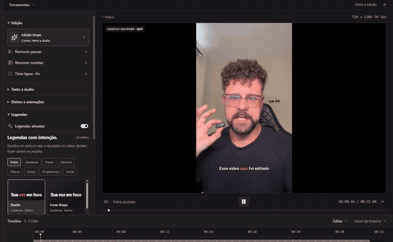
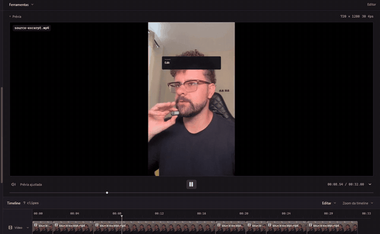
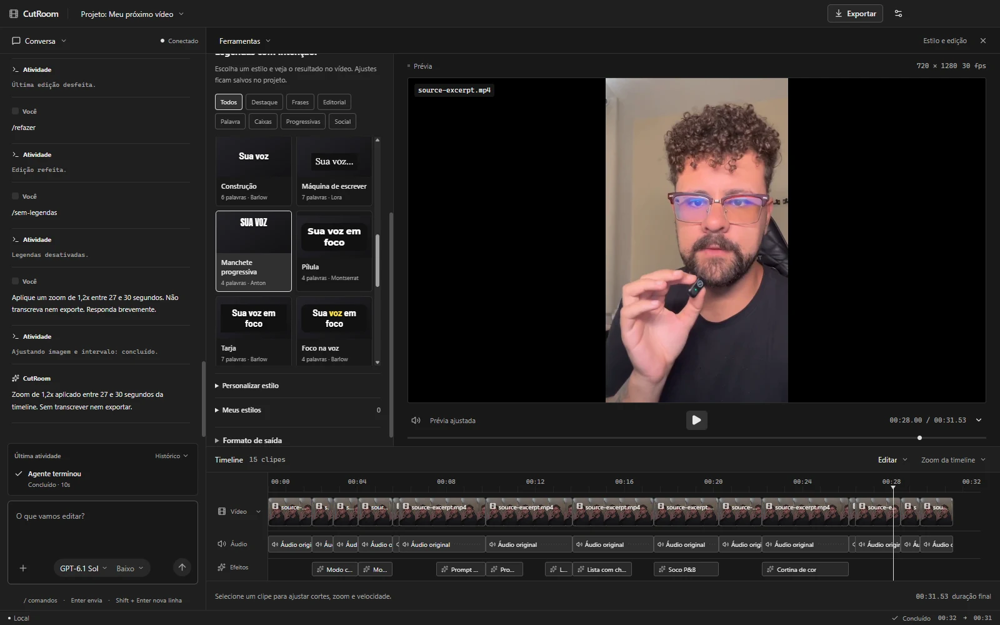

<p align="center">
  
</p>

<p align="center">
  <a href="https://github.com/Mathpcastro/cutroom/releases/latest"></a>
  <a href="https://github.com/Mathpcastro/cutroom/releases/latest"></a>
  <a href="LICENSE"></a>
  <a href="https://github.com/Mathpcastro/cutroom/releases"></a>
</p>

<p align="center">
  Um editor de vídeo desktop controlado por texto.<br />
  Você pede os cortes, as legendas e os efeitos. O CutRoom aplica na timeline.<br />
  <strong>Gratuito, open source e com transcrição e renderização no seu computador.</strong>
</p>

<p align="center">
  <a href="#veja-acontecer">Ver em ação</a> ·
  <a href="#comece-em-quatro-passos">Começar</a> ·
  <a href="#sua-ia-sua-escolha">Conectar sua IA</a> ·
  <a href="docs/commands.md">38 comandos</a> ·
  <a href="CONTRIBUTING.md">Contribuir</a>
</p>

---

## Veja acontecer



<details>
<summary><strong>▶ Assistir à demonstração completa · 43 segundos</strong></summary>

https://github.com/user-attachments/assets/dbfbcb2e-656b-4866-ae57-004bb3d46c15

[Baixar o vídeo em MP4](https://raw.githubusercontent.com/Mathpcastro/cutroom/main/docs/media/cutroom-demo.mp4)

</details>

<p align="center">
  <sub>Gravações reais do CutRoom 0.5.0, montadas com Remotion. Prévia acima acelerada em 2×. O download atual é a versão 0.6.1.</sub>
</p>

## Do pedido ao arquivo final

| Você quer…                     | O CutRoom faz                                                                                                                                  |
| :----------------------------- | :--------------------------------------------------------------------------------------------------------------------------------------------- |
| **Editar conversando**         | Usa as ferramentas do editor para aplicar seus pedidos. Mostra texto e etapas em tempo real; você pode cancelar e desfazer.                    |
| **Dar ritmo à gravação**       | Detecta pausas, remove muletas pela transcrição e aplica a **Edição limpa**, com cortes, zooms discretos e normalização da voz.                |
| **Legendas com identidade**    | Oferece **24 estilos**, seis famílias de fontes offline, karaokê, destaque por palavra, frases progressivas e personalização.                  |
| **Explicar com movimento**     | Cria títulos, destaques, listas, diagramas e cenas originais por texto. A animação entra na faixa **Efeitos**.                                 |
| **Ajustar os detalhes**        | Permite cortar, dividir, enquadrar, mudar velocidade, silenciar trechos e revisar tudo no player e na timeline.                                |
| **Animar do zero**             | Cria um **canvas** de cor sólida, sem precisar de gravação, para montar vinhetas, títulos e cenas animadas.                                    |
| **Editar pelo Claude Desktop** | Com o CutRoom aberto, o **Claude Desktop** controla a timeline ao vivo pela integração MCP local: importa vídeos, edita, transcreve e exporta. |
| **Levar o vídeo pronto**       | Exporta **MP4 H.264/AAC** no PC. Salva e reabre projetos, preservando os arquivos originais.                                                   |

### Sua voz ganha presença. Sua ideia ganha movimento.

<table>
  <tr>
    <td width="50%" valign="top">
      
      <h3>24 estilos de legenda</h3>
      <p>Escolha um preset, ajuste fonte, cor, posição e animação. Confira o resultado no player.</p>
      <a href="docs/captions.md">Conheça o estúdio de legendas →</a>
    </td>
    <td width="50%" valign="top">
      
      <h3>Efeitos na mesma timeline</h3>
      <p>Títulos sobre a gravação ou uma explicação em tela cheia, mantendo sua voz. Prévia e exportação sincronizadas.</p>
      <a href="docs/motion.md">Explore as animações HyperFrames →</a>
    </td>
  </tr>
</table>

## Escreva como você fala

> “Remova as pausas e os ‘né’, sem cortar palavras. Use poucos zooms.”

> “Quando eu explicar as três etapas, mostre um diagrama em tela cheia, mantendo minha voz.”

> “Use o trecho de 30 a 33 segundos como abertura e mantenha também a versão original.”

O agente consulta o projeto, a transcrição e, quando necessário e suportado pelo modelo, quadros reais do vídeo. Cada edição usa o mesmo histórico dos controles manuais.

### Ou use um comando pronto

```text
/edicao-limpa
/legenda-karaoke
/soco-pb PARE AGORA --inicio 2 --fim 4
/lista-check Planejar | Gravar | Publicar --inicio 12 --fim 16
/zoom 1.4 --inicio 2 --fim 5
```

**38 comandos no chat ou no botão +.** São **37 ações prontas sem conectar uma IA** e `/animar` para pedir uma cena original ao agente. Algumas ações exigem os pacotes locais de transcrição ou animação.

[Ver os comandos, parâmetros e exemplos →](docs/commands.md)

## Sua IA, sua escolha

Conecte em **Conversa → Conexão de IA**. Escolha o modelo e, quando disponível, o nível de raciocínio.

| Conexão                       | O que você usa                                                                                                |
| :---------------------------- | :------------------------------------------------------------------------------------------------------------ |
| **Codex / ChatGPT**           | Sessão local do Codex ou chave OpenAI própria. O motor Codex já vem no CutRoom.                               |
| **Claude via terminal**       | CLI oficial do Claude Code instalada separadamente, com a configuração e autenticação do usuário.             |
| **Claude API**                | Sua chave Anthropic.                                                                                          |
| **DeepSeek**                  | Sua chave e os modelos disponíveis na conta.                                                                  |
| **OpenRouter**                | Sua chave e um modelo que declare suporte a ferramentas.                                                      |
| **API compatível com OpenAI** | URL base, modelo e chave do seu serviço. Servidores locais compatíveis, como Ollama, também podem ser usados. |

As chaves informadas ficam **somente na memória da conexão**. Não são salvas nos projetos.

### Ou converse pelo Claude Desktop

O CutRoom também abre um servidor MCP local, só no seu computador. Aponte o **Claude Desktop** para a ponte `cutroom-claude-desktop-bridge.cjs`, que vem no instalador, e peça direto no chat dele: _“crie um canvas de 15 segundos com um título animado”_ ou _“remova os silêncios do vídeo aberto no CutRoom”_. A timeline responde ao vivo.

A conexão só aceita chamadas locais autenticadas por um token salvo na pasta de dados do app. Exportar sempre abre a janela de salvar do CutRoom para você confirmar. Outros clientes que aceitam servidores MCP locais por stdio podem usar a mesma ponte.

[Configurar o Claude Desktop →](docs/providers.md#claude-desktop-integração-mcp-externa)

**O editor é grátis; modelos remotos podem ter custo.** O uso segue os limites do seu plano ou os créditos da sua API. Transcrição e renderização são locais. Metadados, transcrição e quadros solicitados podem ser enviados ao provedor escolhido. Para um modelo no próprio PC, é necessário configurar um servidor local e um modelo com suporte a ferramentas.

[Guia de conexão, privacidade e limites de cada provedor →](docs/providers.md)

<a name="instalar-e-conectar"></a>

## Comece em quatro passos

1. **[Baixe o CutRoom](https://github.com/Mathpcastro/cutroom/releases/latest)** e importe seu vídeo. No Windows x64, use o `CutRoom.Setup….exe`. No Mac, o `CutRoom-…-mac-arm64.dmg` (Apple Silicon: M1 em diante) ou o `CutRoom-…-mac-x64.dmg` (Intel), ainda em prévia. O instalador já inclui FFmpeg; não exige Python global.
2. **Instale os pacotes que precisar** em **Conversa → Pacotes**. **Transcrição local** prepara fala, muletas e legendas. **Efeitos e animações** libera a exportação das cenas animadas.
3. **Escolha um comando ou conecte sua IA.** Comandos prontos não exigem conta de IA; pedidos livres e `/animar` usam o provedor conectado.
4. **Confira, ajuste e exporte.** Use a timeline, desfaça o que quiser e salve seu projeto antes de fechar.

> **Primeira instalação:** os pacotes opcionais baixam centenas de MB. Depois de instalados, a transcrição e a renderização rodam no computador. Cortes manuais e detecção de pausas funcionam sem o pacote de transcrição.

<details>
<summary><strong>Como conectar minha conta ChatGPT ou Claude?</strong></summary>

Para usar a sessão do Codex, caso ainda não esteja conectada no computador:

```powershell
npm install -g @openai/codex
codex login
```

O CutRoom inclui seu próprio motor Codex e reutiliza a autenticação local. Alternativamente, escolha **Codex → Avançado** e informe sua chave OpenAI.

Para Claude, instale a CLI pelo [guia oficial](https://code.claude.com/docs/en/setup), versão 2.1.248 ou superior, e execute no terminal:

```text
claude auth login
```

Depois, selecione **Claude via terminal** no CutRoom. O app usa a CLI oficial sem ler seus tokens. Não é um login próprio do CutRoom com ChatGPT ou Claude. Disponibilidade de modelos e limites dependem da sua conta e da configuração da CLI.

[Ver o guia completo de provedores →](docs/providers.md)

</details>

<details>
<summary><strong>Apareceu um aviso de segurança? Funciona no Mac ou no Linux?</strong></summary>

Os instaladores ainda não têm assinatura de código. Use os [releases oficiais](https://github.com/Mathpcastro/cutroom/releases) e confira o arquivo `SHA256SUMS.txt` antes de decidir executar.

- **Windows:** o SmartScreen pode mostrar um aviso.
- **Mac:** o app não é notarizado pela Apple, então o macOS bloqueia a primeira abertura. Arraste o CutRoom para **Aplicativos**, tente abrir uma vez e vá em **Ajustes do Sistema → Privacidade e Segurança → Abrir Mesmo Assim**.

**Windows x64** é a plataforma validada. A versão **macOS** (Apple Silicon e Intel) é uma **prévia**: os instaladores são gerados e testados automaticamente em Macs da nuvem, mas ainda não houve validação completa com uso real. Relate o que encontrar nas [issues](https://github.com/Mathpcastro/cutroom/issues/new/choose). Linux ainda não é suportado. [Veja o estado da portabilidade](docs/portability.md).

No Windows, as versões que já incluem o atualizador avisam quando há uma novidade e só baixam com sua autorização. Você pode reiniciar para instalar ou deixar para fechar o app. A primeira versão com esse recurso precisa ser instalada manualmente; o macOS continua sem atualização automática. [Como funcionam as atualizações](docs/auto-update.md).

</details>

## Seu espaço para criar

<picture>
  <source media="(prefers-color-scheme: dark)" srcset="docs/media/workspace-dark.webp" />
  <source media="(prefers-color-scheme: light)" srcset="docs/media/workspace-light.webp" />
  
</picture>

**Grafite · Claro · Dark+ · Light+ · Nord · Tokyo Night.** Troque em **Configurações → Aparência**. A escolha fica salva entre sessões. Ações secundárias ficam em menus e painéis sob demanda para manter o vídeo em foco.

## Aberto para construir junto

Encontrou um bug? Quer melhorar uma legenda, adicionar um comando ou ajudar com Mac e Linux? Você pode participar com código, documentação, testes e ideias.

**[Guia de contribuição](CONTRIBUTING.md)** · **[Reportar um problema](https://github.com/Mathpcastro/cutroom/issues/new/choose)** · **[Ver releases](https://github.com/Mathpcastro/cutroom/releases)**

<details>
<summary><strong>Rodar o projeto e gerar um instalador</strong></summary>

Requer **Node.js 24+** e Git.

```powershell
git clone https://github.com/Mathpcastro/cutroom.git
cd cutroom
npm ci
npm run dev
```

```powershell
npm test        # testes automatizados
npm run build  # TypeScript + build de produção
npm run dist   # instalador Windows NSIS em release/
npm run dist:mac  # .dmg macOS em release/ (rodar num Mac; gera a arquitetura da máquina)
```

Os `.dmg` publicados saem do workflow **macOS installers** (`.github/workflows/macos.yml`), que testa e gera as duas arquiteturas em Macs do GitHub Actions. Ao publicar um release, os instaladores e o `SHA256SUMS.txt` atualizado são anexados a ele automaticamente; para um release já existente, rode o workflow à mão informando a tag.

Os binários FFmpeg, ffprobe e Codex vêm das dependências npm. A transcrição instala um runtime privado nos dados do aplicativo, sem modificar seu Python global.

Validação da versão 0.6.0: **106 testes**, build e verificações do app empacotado passaram. Novos provedores foram exercitados com APIs de teste; o fluxo da CLI oficial + MCP usou um modelo local simulado. A inferência externa da CLI excedeu o prazo e não é declarada como validada. [Detalhes do release](docs/releases/v0.6.0.md).

</details>

<details>
<summary><strong>Como o CutRoom funciona por dentro</strong></summary>

| Camada               | Implementação                                                                                                                                   |
| :------------------- | :---------------------------------------------------------------------------------------------------------------------------------------------- |
| Desktop e interface  | Electron, React e TypeScript; ponte IPC isolada, sem Node no renderer.                                                                          |
| Timeline e histórico | Projeto declarativo compartilhado pelas ações manuais e pelas ferramentas da IA.                                                                |
| Agentes              | Codex App Server por stdio; Claude Code externo com MCP local; Anthropic Messages e APIs de Chat Completions compatíveis no processo principal. |
| Clientes externos    | Servidor MCP em `127.0.0.1` com token, usado pelo Claude Desktop por meio de uma ponte stdio.                                                   |
| Vídeo e áudio        | FFmpeg/ffprobe, H.264/AAC e normalização em duas passagens.                                                                                     |
| Transcrição          | Faster Whisper, runtime privado e modelo multilíngue instalados sob demanda.                                                                    |
| Legendas             | JASSUB/libass na prévia, com gerador ASS compartilhado pela exportação.                                                                         |
| Animações            | HyperFrames, HTML/CSS e movimentos GSAP declarativos; renderização local com cache.                                                             |

O agente recebe sete ferramentas do editor: ler projeto, editar, transcrever, inspecionar quadro, exportar, criar canvas e importar vídeos. A importação aceita somente arquivos de vídeo. Não recebe acesso livre a shell, arquivos ou plugins.

**Remotion foi usado no filme de apresentação deste README.** O motor de efeitos dentro do aplicativo é HyperFrames. O editor não exige um backend CutRoom hospedado, telemetria própria ou uma conta CutRoom.

[Pacotes locais](docs/packages.md) · [Animações](docs/motion.md) · [Legendas](docs/captions.md) · [Análise dos projetos de referência](docs/upstream.md)

</details>

<details>
<summary><strong>Limites da prévia e revisão antes de publicar</strong></summary>

- Tempos de transcrição podem ser imprecisos, especialmente em hesitações. Confira os cortes e as legendas.
- Presets não detectam automaticamente rosto ou atividade na tela; o agente pode inspecionar quadros e ajustar o foco.
- Arredondamentos de frames podem produzir diferenças entre timeline e MP4 em cortes fracionários. Assista ao arquivo exportado.
- A exportação usa CPU, pode levar tempo e ocupar espaço temporário considerável.
- O modelo precisa oferecer suporte a ferramentas. Servidores locais e contas externas têm seus próprios requisitos, limites e disponibilidade.
- O catálogo de pacotes é uma base inicial; ainda não há instalação arbitrária de plugins ou marketplace público.

</details>

---

<p align="center">
  <strong>Seu próximo vídeo começa com uma frase.</strong><br /><br />
  <a href="https://github.com/Mathpcastro/cutroom/releases/latest"><strong>↓ Baixar CutRoom de graça</strong></a>
</p>

<p align="center">
  <sub>Feito por Matheus Castro · Código original sob <a href="LICENSE">MIT</a> · Dependências mantêm suas <a href="THIRD_PARTY_NOTICES.md">próprias licenças</a>.<br />
  <a href="docs/media/README.md">Origem e reprodução das demonstrações</a></sub>
</p>
