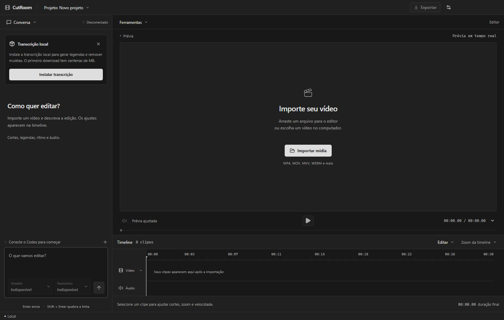
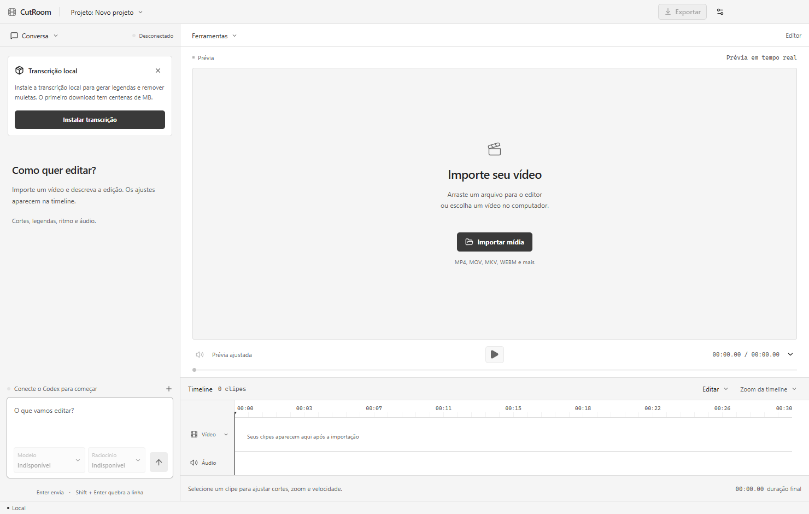
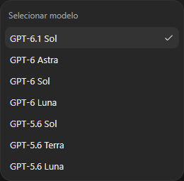
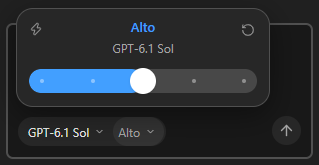

# CutRoom

Um editor de vídeo desktop controlado por texto. Converse com seu Codex, acompanhe a edição no player e ajuste os detalhes na timeline. Os arquivos e a renderização ficam no seu computador.

**Open source · Windows x64 · versão inicial em desenvolvimento**

[Baixar a prévia para Windows](https://github.com/Mathpcastro/cutroom/releases/tag/v0.5.0)

| Grafite | Claro |
| --- | --- |
|  |  |

| Modelo | Raciocínio |
| --- | --- |
|  |  |

## O que funciona

- Chat à esquerda e workspace de vídeo à direita, com player, mídia, transcrição e timeline.
- Catálogo de 38 comandos no botão **+** e atalhos `/`, com busca, explicações e parâmetros. São 37 ações prontas sem conexão de IA e `/animar` para cenas originais via Codex. Veja o [catálogo e exemplos](docs/commands.md).
- Interface minimalista com ações agrupadas em menus e painéis sob demanda. Seis temas: Grafite, Claro, Dark+, Light+, Nord e Tokyo Night, com a escolha salva em **Configurações → Aparência**.
- Codex App Server empacotado: reutiliza a sessão local do Codex, sem conta ou cadastro CutRoom.
- Seletores compactos no estilo Codex: modelos em linhas simples e nível de raciocínio em uma barra deslizante, conforme as opções da conta. Navegação por teclado e botão para restaurar o esforço padrão do modelo.
- Progresso ao vivo no chat: etapas do agente, ferramentas, processamento local, conclusão, falhas e cancelamento.
- Opção de chave OpenAI própria, mantida somente na memória da conexão local.
- Cortar/dividir trechos, desfazer/refazer, ajustar zoom/foco, velocidade e áudio.
- Detectar pausas e remover muletas a partir da transcrição, preservando expressões como “tipo de” e o verbo “é”.
- Preset **Edição limpa**, adaptado da skill de edição de Matheus Castro.
- Estúdio de legendas com 24 presets, seis famílias de fontes offline, karaokê, destaque por palavra, frases progressivas, animações e estilos personalizados. A prévia usa JASSUB/libass; veja [docs/captions.md](docs/captions.md).
- Títulos, frases em tela cheia, callouts, fluxos, promoção, capa e hook.
- Efeitos HyperFrames por texto: seis modelos e cenas originais em HTML/CSS com movimentos GSAP; prévia sincronizada, faixa Efeitos, desfazer/refazer e renderização local com cache. Veja [como usar](docs/motion.md).
- Recuperação automática de erros do monitor com uma prévia H.264 local, sem alterar o arquivo original.
- Normalização de áudio em duas passagens e exportação local H.264/AAC MP4.
- Salvar/reabrir projetos; os vídeos originais são preservados.
- Pacote instalável de transcrição local Faster Whisper, com Python privado e modelo multilíngue. Depois da instalação, transcreve offline.

## Instalar e conectar

O instalador de prévia está em [Releases](https://github.com/Mathpcastro/cutroom/releases). Esta versão é para **Windows x64**. Não é necessário instalar Python ou FFmpeg para usar o instalador.

O app não tem autenticação própria. Para usar o plano ChatGPT, primeiro conecte o CLI oficial do Codex no seu computador:

```powershell
npm install -g @openai/codex
codex login
```

O npm/CLI é necessário somente para preparar uma sessão caso você ainda não tenha Codex conectado. O CutRoom inclui seu próprio motor Codex e reutiliza a autenticação local existente. Alternativamente, em **Conectar Codex → Usar minha chave de API**, informe sua própria chave OpenAI. Ela não é incluída no projeto nem salva pelo CutRoom.

1. Arraste um vídeo para o editor ou escolha **Projeto → Importar mídia**.
2. Abra **Conversa → Conexão Codex**.
3. O aviso da primeira abertura leva a **Pacotes**, também disponível no menu **Conversa**. Instale **Transcrição local** para remover muletas, aplicar a edição limpa completa e criar legendas. O download ocupa centenas de MB e exige internet na primeira instalação. Depois, essas ações preparam a transcrição automaticamente quando necessário. Cortes manuais e detecção de pausas funcionam sem esse pacote.
4. Peça uma edição no chat, confira o resultado e clique em **Exportar**.

Para títulos animados, diagramas e cenas explicativas, instale **Efeitos e animações** em Pacotes. A prévia já funciona antes do download; o pacote é necessário para exportar cenas. Os controles ficam em **Ferramentas → Estilo e edição → Efeitos e animações**. Exemplo: “Anime estas três etapas em tela cheia quando eu começar a explicação, mantendo minha voz”.

**Ferramentas** abre mídia, transcrição ou estilo e edição. A timeline agrupa cortes e histórico em **Editar**, e ampliação em **Zoom da timeline**. Salve pelo menu do projeto ou `Ctrl+S`; abra um projeto com `Ctrl+O`. `Ctrl+,` abre a aparência.

Exemplos:

> Transcreva o vídeo, remova os silêncios e os “né” sem cortar palavras. Use poucos zooms.

> Adicione um callout com “Tudo roda no seu PC” entre 4 e 7 segundos da timeline.

> Divida o trecho em 12 segundos da fonte e acelere a espera para 6x, sem áudio.

> Use o trecho de 30 a 33 segundos como teaser no início, mantendo também a versão original no vídeo.

O app é gratuito. A inferência usa os limites do seu plano Codex/ChatGPT ou os créditos da sua API. A transcrição local e a renderização não consomem créditos de IA. Texto da transcrição e frames solicitados pelo agente podem ser enviados ao provedor da IA; “local” não significa que o modelo de chat roda offline.

## Desenvolvimento

Requer Node.js 24+ e Git. Os binários FFmpeg, ffprobe e Codex vêm das dependências npm.

```powershell
git clone https://github.com/Mathpcastro/cutroom.git
cd cutroom
npm ci
npm run dev
```

```powershell
npm test
npm run build
npm run dist
```

`npm run dist` gera o instalador NSIS em `release/`. A transcrição baixa um runtime independente dentro dos dados do aplicativo; não usa nem modifica o Python global. Builds para macOS/Linux não foram validados e o pacote de transcrição inicial foi preparado para Windows x64.

## Arquitetura

- **Electron/React/TypeScript**: interface e ponte isolada, sem Node no renderer.
- **Projeto declarativo**: as ações manuais e a IA alteram o mesmo modelo, com histórico reversível.
- **Codex App Server por stdio**: sessão local, ferramentas de edição próprias e streaming. Integrações herdadas, shell e plugins são desativados para a conversa do editor.
- **FFmpeg/ffprobe**: processamento por subprocessos, com argumentos separados e gráficos em arquivos.
- **Faster Whisper**: worker Python com dependências fixadas por hash e modelo de revisão fixada, instalado sob demanda.
- **JASSUB/libass**: renderizador de legendas ASS com worker, WebAssembly e fontes empacotados; gerador compartilhado com a exportação FFmpeg.

Não há Remotion, backend hospedado, telemetria própria ou login CutRoom. Não há dependência do OpenCut ou do LosslessCut. A análise de reaproveitamento está em [docs/upstream.md](docs/upstream.md).

## Pacotes e evolução

A aba Pacotes é a primeira base para um catálogo gratuito de motores locais. O pacote de transcrição já fornece fala, tempos por palavra e dados para legendagem. Novos pacotes devem declarar versão, plataforma, tamanho, dependências, licença e capacidades; veja [docs/packages.md](docs/packages.md). Submissões públicas e instalação arbitrária de plugins não fazem parte desta versão.

## Limites desta versão

- O modelo de chat depende de internet e da sua conta. Login customizado “Sign in with ChatGPT” e suporte Claude não estão implementados.
- Presets não detectam rosto/atividade de tela automaticamente; o agente pode inspecionar frames e comandar foco e velocidade.
- Tempos ASR podem ser imprecisos, especialmente em hesitações. Revise os cortes. Tokens sem duração são unidos ao texto vizinho sem inventar novos tempos.
- Player mostra uma composição interativa. As legendas compartilham o gerador ASS com a exportação; cortes com durações fracionárias de frame ainda podem acumular diferenças de tempo entre timeline e MP4. Confira o resultado exportado.
- A exportação inicial usa CPU. Pode ocupar espaço temporário considerável e levar tempo em vídeos longos.
- Instaladores iniciais não têm assinatura de código. Não há promessa de suporte comercial.

## Licenças

O código original do CutRoom é [MIT](LICENSE). Dependências e binários conservam suas próprias licenças, incluindo Codex Apache-2.0, Barlow OFL e FFmpeg GPLv3. Consulte [THIRD_PARTY_NOTICES.md](THIRD_PARTY_NOTICES.md) e os avisos distribuídos em `resources/licenses/`.
