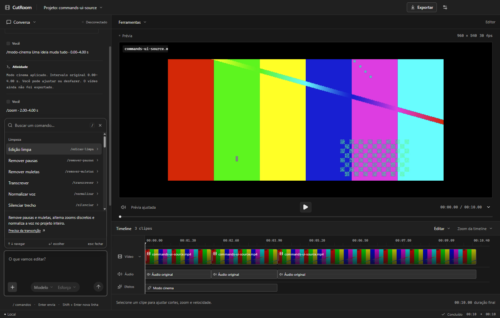

# Comandos do chat

O botão **+** no compositor abre o catálogo de 38 comandos. Busque pelo nome e passe o mouse ou use as setas para ler a explicação. Comandos que precisam de texto ou intervalo abrem ajustes compactos; os demais são aplicados ao clicar. Os controles de modelo/raciocínio continuam no mesmo lugar.

Também é possível digitar um comando completo e pressionar Enter:

```text
/remover-pausas
/soco-pb PARE AGORA --inicio 2 --fim 4
/modo-cinema Uma ideia muda tudo --inicio 4 --fim 8
/prompt-digitando Crie uma legenda com destaque --inicio 8 --fim 12
/lista-check Planejar | Gravar | Publicar --inicio 12 --fim 16
/cortina-cor --inicio 16 --fim 20
/zoom 1.4 --inicio 2 --fim 5
/legenda-karaoke
```

Digitar um prefixo, como `/zo`, abre sugestões; Enter completa a opção. Digitar `/zoom` inteiro e Enter aplica os valores padrão. Escape fecha a lista. O chat normal continua aceitando pedidos livres.

## Intervalos e parâmetros

Os tempos usam segundos da **timeline editada**, depois dos cortes e velocidades. Se houver um clipe selecionado, seu intervalo é o padrão. Sem seleção, o padrão começa no cursor e dura até quatro segundos; silenciar, time-lapse e câmera lenta usam o clipe atual. Você pode ajustar antes de aplicar ou informar `--inicio` e `--fim`.

- `--inicio 2` e `--fim 5`: intervalo; aliases `--de` e `--ate` também funcionam.
- `--valor 1.4`: ampliação ou velocidade. Nos comandos numéricos, basta `/zoom 1.4`.
- Texto após o comando ou `--texto "Minha frase"`.
- `--subtitulo "Complemento"`: complemento de um título, identificação ou CTA.
- Listas separadas por `|`, ou `--itens "Planejar | Gravar | Publicar"`.

Texto tem até 500 caracteres. Prompt digitando aceita até 140; Soco P&B aceita até três palavras. Listas têm de um a seis itens de até 300 caracteres. Cada efeito animado dura até 120 segundos. Valores inválidos mostram um erro sem aplicar uma edição parcial.

## Catálogo



[Ver no tema Claro](screenshots/commands-light.png).

| Grupo | Comandos |
| --- | --- |
| Limpeza | `/edicao-limpa`, `/remover-pausas`, `/remover-muletas`, `/transcrever`, `/normalizar`, `/silenciar` |
| Imagem | `/soco-pb`, `/modo-cinema`, `/cortina-cor`, `/zoom`, `/pb`, `/cor-viva`, `/espelhar`, `/desfocar`, `/vinheta` |
| Animações | `/titulo`, `/identificacao`, `/destaque`, `/prompt-digitando`, `/lista-check`, `/etapas`, `/diagrama`, `/numero`, `/citacao`, `/cta`, `/barra-progresso`, `/contador` |
| Ritmo | `/timelapse`, `/camera-lenta` |
| Legendas | `/legendar`, `/legenda-karaoke`, `/legenda-palavra`, `/sem-legendas` |
| Projeto | `/dividir`, `/desfazer`, `/refazer`, `/exportar` |
| IA | `/animar` |

Soco P&B combina zoom, imagem monocromática e palavras de impacto. Modo cinema combina barras, dessaturação e frase com fade. Cortina de cor revela a imagem com cor viva da esquerda para a direita sobre P&B; é um efeito real de vídeo, com linha luminosa sincronizada. Prompt digitando e Lista com checks são cenas determinísticas, prontas para usar sem pedir ao agente que programe.

`/desfocar` desfoca o quadro inteiro. `/espelhar` inverte horizontalmente. `/timelapse` usa 4× e silencia somente o intervalo; `/camera-lenta` usa 0,5× mantendo o áudio ajustado. `/dividir 2.5` divide no segundo 2,5 da timeline; sem número, divide no cursor. `/normalizar` ajusta a exportação para −14 LUFS; o monitor não simula o processamento de áudio em duas passagens.

## Conexão, pacotes e histórico

Os **37 comandos prontos** executam no aplicativo sem Codex ou API key. Transcrição, muletas, legendas e edição limpa precisam das palavras do vídeo; se ainda não estiverem no projeto, instale **Transcrição local** em **Conversa → Pacotes**. Remover pausas funciona sem transcrição.

Animações têm prévia imediata. Para exportá-las, instale **Efeitos e animações**, incluindo Soco P&B e Modo cinema. P&B, zoom, cor viva, espelhamento e demais ajustes de imagem sem cenas usam diretamente o FFmpeg incluído.

Somente `/animar` envia um pedido ao Codex conectado, usando seu modelo e nível de raciocínio. Usa os limites da conta ou créditos da sua chave. O agente cria uma cena original em vez de executar um dos modelos prontos.

Cada comando composto é uma alteração reversível: um `/desfazer` remove junto a imagem, o zoom e a cena que ele criou. O progresso aparece na conversa; os arquivos originais são preservados. Exportar abre a escolha do arquivo antes de renderizar. O catálogo não promete recorte automático de pessoa, rastreamento facial ou efeitos 3D que este motor ainda não implementa.
