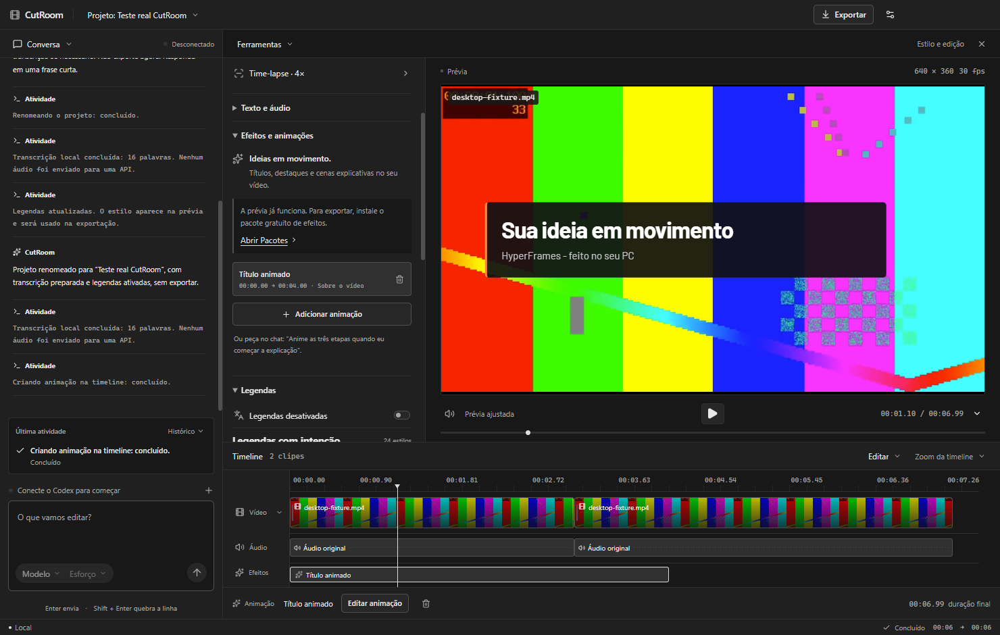
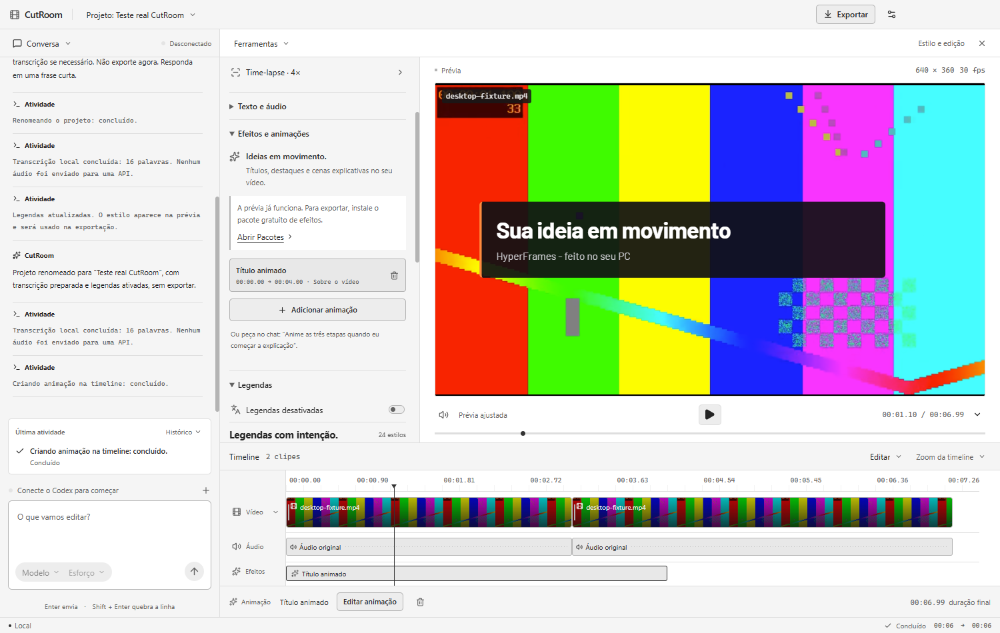

# Efeitos e animações

O CutRoom usa o player e o produtor oficiais do [HyperFrames](https://github.com/heygen-com/hyperframes), versão 0.8.173. A integração funciona no Windows x64, sem Node, npm ou terminal no computador de quem instala o app.

| Grafite | Claro |
| --- | --- |
|  |  |

## Usar

1. Em **Conversa → Pacotes**, instale **Efeitos e animações**. O download único instala um navegador privado do renderizador nos dados do CutRoom. Não altera seu Chrome.
2. Importe o vídeo e peça no chat, por exemplo: “Mostre as três etapas em uma animação em tela cheia de 10 a 15 segundos, mantendo minha voz”. Para encontrar um trecho pela fala, instale também Transcrição local.
3. Confira a prévia. Em **Ferramentas → Estilo e edição → Efeitos e animações**, ajuste texto, intervalo, composição e cores. Há seis modelos: título, identificação, destaque, etapas, número e diagrama. O agente também cria layouts originais.
4. As cenas aparecem na faixa **Efeitos**. Clique para editar; remova pelo painel ou menu Editar. Desfazer/refazer e salvar projeto incluem as cenas.
5. Exporte normalmente. As cenas são renderizadas no PC e combinadas com o vídeo pelo FFmpeg, mantendo o áudio original, os cortes e as legendas. Cenas sem mudanças reutilizam o cache.

A prévia funciona mesmo antes de baixar o pacote; a exportação com animações exige sua instalação. Não há cobrança de renderização. A conversa continua usando o plano Codex/ChatGPT ou a chave de API do usuário.

## Cenas personalizadas

Uma cena contém um fragmento HTML/CSS e uma lista de movimentos GSAP declarativos. O agente usa a ferramenta `edit_project` com o comando `motion`. O usuário não precisa programar. Os ajustes avançados expõem HTML/CSS e JSON para quem quiser editar diretamente.

```json
{
  "name": "motion",
  "args": {
    "name": "Minha ideia",
    "start": 2,
    "end": 5,
    "mode": "overlay",
    "html": "<div class='title' style='position:absolute;left:10%;top:20%;color:white;font:700 80px Barlow'>Minha ideia</div>",
    "animations": [
      { "selector": ".title", "start": 0, "duration": 0.4, "from": { "opacity": 0, "y": 30 }, "to": { "opacity": 1, "y": 0 }, "ease": "power2.out" },
      { "selector": ".title", "start": 2.6, "duration": 0.4, "to": { "opacity": 0 } }
    ]
  }
}
```

O início/fim usam segundos da **timeline editada**. Os movimentos usam segundos locais da cena. O canvas de autoria tem 1920 pixels de largura, com altura proporcional à saída; o aplicativo escala para a resolução do projeto. Barlow Regular/Bold está incorporada e funciona offline. Cada cena aceita até 120 segundos, seis itens de preset e 100 movimentos; cada projeto aceita até 100 cenas.

Esta versão não importa projetos HyperFrames arbitrários: scripts livres, recursos externos, vídeos dentro da cena e relógios CSS independentes não são aceitos. HTML/CSS, SVG inline e a lista de movimentos cobrem títulos, diagramas e cenas explicativas. A prévia roda em iframe de origem opaca, sem acesso ao aplicativo, arquivos ou rede; apenas os scripts confiáveis do player/GSAP podem executar.

## Renderização e cache

O pacote verifica SHA-256 do navegador versionado antes de instalar. O produtor roda em subprocesso privado do aplicativo e gera ProRes 4444 com alfa; o FFmpeg compõe as cenas antes das legendas. O cache inclui conteúdo, movimentos, duração, modo, fundo, resolução, FPS e versão do motor. Alterar apenas a posição de uma cena permite reutilizar o render.

Cortes e mudanças de velocidade preservam a fase da animação junto ao conteúdo sobrevivente. A exportação ajusta os segmentos ao arredondamento de frames dos clipes. Cancelar interrompe somente a árvore do renderizador do CutRoom e preserva uma exportação anterior. O navegador ocupa aproximadamente 300 MB instalado; renders intermediários podem ocupar mais espaço, principalmente em resoluções altas.

O HyperFrames usa Apache 2.0; a licença está incluída em `resources/licenses`. O pacote do navegador mantém seus avisos de terceiros. Remotion não foi adicionado.
